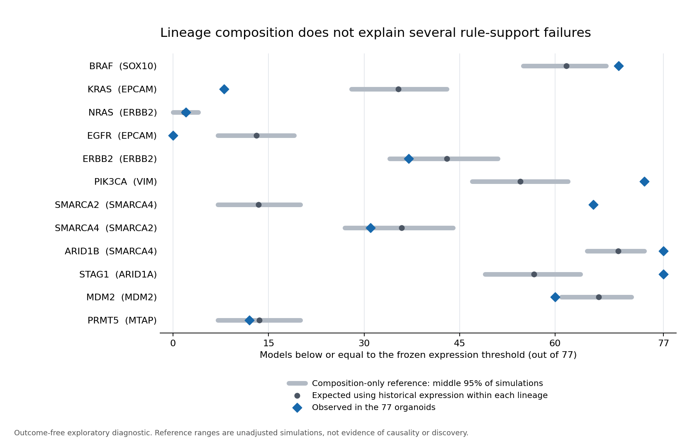

# Contributor-style trial: explain frozen rule-support failures

**A useful diagnostic contribution was completed. Several failed rules remain
poorly supported after accounting for the changed lineage mix. No improved
predictor or new biological discovery is claimed.**

This is a new author-performed contributor-style investigation, following the
completed frozen external evaluation. It is not another replay presented as a new
trial, and it is not an independent newcomer test. The bounded task was to explain
support failures and deliver a reusable check. The 60-minute limit was an upper
bound, not a required duration; actual recorded time is in `session.json`.

## What the contributor produced

- `src/support_diagnostic.py`: all-30-gene distribution audit, all-12-rule support
  check, common-lineage decomposition and composition-only simulation reference.
- `diagnostic.json`: reproducible evidence, exact source bindings, all feature
  distributions, all lineage cells and all target results.
- Five tests covering pure composition shifts, within-lineage shifts, unmatched
  lineages, outcome insensitivity, identity/support errors and actual forbidden-file
  access guards. The full suite now passes **38 tests**; the real-input guard ran.
- A documented unsuccessful matched-model bridge attempt, a scientific review
  handoff and a bounded follow-up task. No thresholds or predictive candidates
  were fitted, recalibrated or selected during this investigation.



## What the new investigation establishes

**The named measurement units and extraction are consistent.** The old publisher
README documents unstranded log2(TPM+1) expression, as does the new manuscript
README. Inspection of `src/prepare.py` shows the old unstranded expression matrix
was extracted without another logarithm or expression-scale conversion. The
frozen stable Entrez identifiers reproduce **all 2,310 new expression values**
(77 models × 30 genes) exactly from the raw manuscript matrix. All 12 old branch
counts reproduce from the 773-row development extract. No extraction or threshold
application error was found by these checks. This does not prove identical
quantification pipelines, annotations, molecular samples or normalization.

**Lineage mix explains part, but not all, of the observed support changes.** All
77 organoids belong to nine lineage labels represented by **232** of the 773 old
development models. We keep the empirical expression distribution within each old
lineage and reweight it to the organoid lineage counts. The comparison therefore
uses the same lineage composition on each side. In 2,000 deterministic resamples,
old rows are sampled with replacement within lineage to match all 77 new lineage
positions. The same row draws are used across rules.

The SMARCA2 dependency rule uses SMARCA4 expression. With the new lineage mix but
old within-lineage expression, the expected count below its frozen threshold is
**13.38/77**, with a middle-95% simulation range of **7–20**. The actual count is
**66/77**. The STAG1 rule similarly has an expected **56.70/77** below its ARID1A
threshold versus **77/77** observed. EGFR has **13.07/77** expected below its EPCAM
threshold versus **0/77** observed. These discrepancies warrant an explanation
beyond changing the proportions of the recorded lineage categories.

By contrast, the NRAS rule's expected count is **1.75/77**, versus **2/77** observed.
Its branch imbalance is consistent with the new lineage mix and the old
within-lineage distributions. PRMT5, ERBB2 and SMARCA4 are also inside their
composition-reference ranges. The ranges are descriptive and unadjusted: eight
outside-range counts are not eight significant findings, and falling inside a
range does not establish equivalence or successful prediction.

Only ERBB2, MDM2 and SMARCA4 meet the inherited requirement of at least 15 models
in each branch. The unchanged rules for ARID1B, EGFR and STAG1 put every organoid
on one side and cannot rank the external models.

| Dependency target | Expression feature | Old full-cohort below / n | Composition reference below / 77 | Reference range | Actual below / 77 | Actual branch support |
| --- | --- | ---: | ---: | --- | ---: | --- |
| BRAF | SOX10 | 619 / 773 | 61.77 | 55–68 | 70 | insufficient |
| KRAS | EPCAM | 618 / 773 | 35.37 | 28–43 | 8 | insufficient |
| NRAS | ERBB2 | 155 / 773 | 1.75 | 0–4 | 2 | insufficient |
| EGFR | EPCAM | 464 / 773 | 13.07 | 7–19 | 0 | insufficient |
| ERBB2 | ERBB2 | 618 / 773 | 42.99 | 34–51 | 37 | adequate |
| PIK3CA | VIM | 309 / 773 | 54.52 | 47–62 | 74 | insufficient |
| SMARCA2 | SMARCA4 | 155 / 773 | 13.38 | 7–20 | 66 | insufficient |
| SMARCA4 | SMARCA2 | 310 / 773 | 35.87 | 27–44 | 31 | adequate |
| ARID1B | SMARCA4 | 618 / 773 | 69.91 | 65–74 | 77 | insufficient |
| STAG1 | ARID1A | 464 / 773 | 56.70 | 49–64 | 77 | insufficient |
| MDM2 | MDM2 | 619 / 773 | 66.82 | 61–72 | 60 | adequate |
| PRMT5 | MTAP | 155 / 773 | 13.54 | 7–20 | 12 | insufficient |

## Decomposition and its limits

For each rule, the machine-readable report records:

1. The below-threshold fraction in the full old development cohort.
2. That fraction restricted to the nine shared lineage labels.
3. The old within-lineage fractions reweighted by the new lineage frequencies.
4. The observed fraction in the new organoids.

The reported `composition_component` is (3) − (2), and the
`within_lineage_component` is (4) − (3). Their sum is exactly the total change
**within common lineage support**, (4) − (2). Removing old lineages absent from the
new cohort is the separate change (2) − (1); it is not silently included in those
two components. No new lineage is unmatched here. The generic implementation
reports unmatched new identities explicitly and excludes them only from this
common-support decomposition, retaining full-cohort branch counts separately.

Prostate has only six old development models and Ampulla of Vater only two;
within-lineage reference distributions are consequently fragile. The simulation
conditions on observed old distributions and does not include uncertainty in those
distributions. Exact metadata lineage labels are used, without subtype balancing.
Provisional donor grouping and unobserved relationships remain limitations.

At the gene-distribution level, median expression is lower for 23 of the 30 panel
genes and higher for seven. In old-development IQR units, SMARCA4 shifts −1.339,
ARID1A −1.263, VIM −1.076 and EPCAM +0.848. These are descriptive full-cohort
comparisons, including lineage composition effects. A single uniform expression
offset is not justified by this pattern, and no normalization fix was applied.

## What remains unresolved

Different within-lineage distributions could reflect model biology, sample/culture
selection, RNA processing, gene annotation or combinations of these. This audit
cannot identify the cause. Nor does it explain all of the compact two-feature
models' negative aggregate transfer result: this task investigated the separate
one-feature comparator's support.

An exploratory extension sought same-ModelID expression pairs across releases.
There are **zero** shared ModelIDs between the 773 development identities and the
309 rows in `next_gen_expression.csv`. This does not rule out aliases or related
models; it only rules out that exact-ID bridge. A second documented extension
attempted to download the manuscript companion `traditional_expression.csv`,
which could provide matched development models. Chrome blocked that download with
`ERR_BLOCKED_BY_CLIENT` for storage.googleapis.com; no file arrived and the block
was not bypassed. No matched-model shifts or calibration results are fabricated.
The two amendments and `bridge-attempt.json` preserve the exploratory sequence.

The most useful next task is the matched-development-model expression audit once
the companion file is available, with sample/profile IDs checked before calling
any difference technical. That requires no dependency outcomes or Sanger access.
A scientific reviewer should then decide whether any harmonization is justified.

## Contributor experience and project assessment

The session produced a checked diagnostic and discriminated among failure
explanations without needing a model-score win. This supports a bounded robustness
workstream for a supervised pilot. It does not validate independent onboarding,
review capacity or public readiness. The same primary agent had prior repo and
result context; a new contributor will have a different starting cost.

The useful workflow change is to inspect rule support and distribution compatibility
before spending contributor time optimizing or interpreting external scores. A
rule with all models in one branch should be reported as unsupported for ranking,
not presented as an unexplained algorithmic loss. The diagnostic preserves every
selected target and reports weak support instead of selecting an easier benchmark.

Broad is already exposed exploratory evidence. No additional dependency outcome
file was opened for this task, no new performance estimate was produced, and
Sanger remains reserved. The prior external result is unchanged: compact minus
strong mean Spearman −0.04613, conditional 95% interval [−0.10689, +0.01843].
Scientific-owner appointment and independent assay/identity review remain pending.

## Reproduce

From the repository root with the locked environment and existing local expression
matrix (raw files stay in ignored `data/raw/`):

```sh
python3 research/contributor-support-20261021/check_manifest.py
.venv/bin/python src/support_diagnostic.py verify --inputs data/raw/transfer-trial-20261021
.venv/bin/python research/contributor-support-20261021/check_bridge.py --inputs data/raw/transfer-trial-20261021
.venv/bin/python -m pytest tests/test_support_diagnostic.py -q
```

`run` creates the diagnostic exclusively and refuses to overwrite it. `verify`
recomputes the complete audit and compares every field. The real-input test guards
both Python file-opening entry points against response matrices, Sanger files,
historical panel files and the previous external result file. Historical
preparation and result manifests remain unchanged. Plot source and PNG/SVG outputs
are included; no web publication or push occurred.

Sources: [DepMap Public 24Q2 v1](https://doi.org/10.25452/figshare.plus.25880521.v1),
its locally pinned `setup/sources/depmap-24q2-README.txt`, the
[NextGen Model Manuscript 2026 release](https://depmap.org/portal/data_page/?releasename=NextGen+Model+Manuscript+2026&tab=allData)
and its locally hashed README. Attribution: Broad Institute DepMap; Neiswender,
Maffa, Brenan et al., [Nature (2026)](https://doi.org/10.1038/s41586-026-10843-7).
Data retain publisher terms; the previously authorized internal-research use
continues, and no redistribution permission is inferred for raw expression values.
